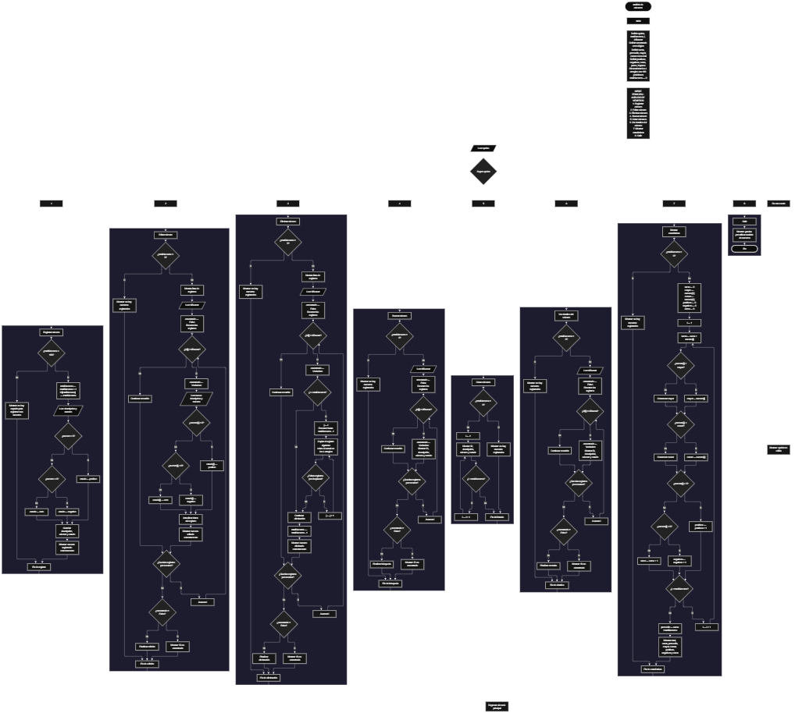

 

Este proyecto, llamado <b>análisis de números</b>, fue desarrollado en <b>pseint</b> como un ejercicio práctico para fortalecer la lógica de programación mediante la creación de un sistema de gestión de números desde la consola. El programa cuenta con un menú principal de ocho opciones que permite <b>registrar, editar, eliminar, buscar, listar y consultar los detalles de los números registrados, además de mostrar estadísticas generales</b>. Cada registro almacena un identificador, una descripción, un valor numérico y un estado que clasifica automáticamente el número como positivo, negativo o cero. Para organizar la información, se utilizan cuatro arreglos con una capacidad máxima de <b>100 registros durante la ejecución</b>. Durante su desarrollo se aplicaron conceptos fundamentales de programación, como variables, arreglos, estructuras condicionales, ciclos repetitivos y estructuras de selección, además de procedimientos para buscar, modificar, eliminar y recorrer registros. Este proyecto permite poner en práctica los conocimientos adquiridos en PSeInt y sirve como base para desarrollar sistemas de análisis y gestión de datos más avanzados.

<h2 align="center">⚙️ Funcionamiento del menú principal</h2>

### ➕ Registrar número

La opción <b>1) registrar número</b> permite almacenar un nuevo número acompañado de una descripción. Antes de realizar el registro, el programa comprueba que la cantidad de números almacenados sea menor que <b>100</b>, mediante la condición <b>totalNumeros &lt; 100</b>. Si existe espacio disponible, incrementa la variable <b>totalNumeros</b> en uno y asigna el valor actual del contador al arreglo <b>id</b>. Después, solicita la descripción y el valor numérico, que se almacenan en los arreglos <b>descripcion</b> y <b>numero</b>. A continuación, clasifica automáticamente el número: si es mayor que cero, guarda el estado <b>"positivo"</b>; si es menor que cero, guarda <b>"negativo"</b>; y si es igual a cero, guarda <b>"cero"</b>. Finalmente, muestra el mensaje <b>"numero registrado correctamente."</b>. Si se alcanza la capacidad máxima, presenta el mensaje <b>"no hay espacio para registrar mas numeros."</b> e impide agregar otro registro.

### ✏️ Editar número

La opción <b>2) editar número</b> permite modificar la descripción y el valor numérico de un registro existente. Primero, el programa comprueba si la variable <b>totalNumeros</b> es igual a cero. Si no existen registros, muestra el mensaje <b>"no hay numeros registrados."</b>. En caso contrario, presenta una lista con el ID, la descripción, el número y el estado de cada registro. Después, solicita el ID del número que se desea editar e inicializa la variable lógica <b>encontrado</b> con el valor <b>Falso</b>. Mediante un ciclo <b>para</b>, recorre los identificadores y compara cada uno con el valor introducido. Si encuentra una coincidencia, cambia <b>encontrado</b> a <b>Verdadero</b>, solicita la nueva descripción y el nuevo número, y actualiza el estado según el signo del valor ingresado. Finalmente, muestra el mensaje <b>"numero editado correctamente."</b>. Si termina el recorrido sin encontrar el ID solicitado, presenta el mensaje <b>"no se encontró un numero con ese id."</b>.

### 🗑️ Eliminar número

La opción <b>3) eliminar número</b> permite eliminar un registro mediante su identificador. Primero, comprueba si existen números registrados. Si no hay información almacenada, muestra el mensaje <b>"no hay numeros registrados."</b>. Si existen registros, presenta una lista con el ID, la descripción, el número y el estado de cada uno. Después, solicita el ID que se desea eliminar e inicializa <b>encontrado</b> con el valor <b>Falso</b>. El programa recorre los registros hasta encontrar una coincidencia. Cuando encuentra el ID, cambia la variable a <b>Verdadero</b> y, si el registro no se encuentra en la última posición, utiliza un ciclo <b>para</b> controlado por la variable <b>j</b> para desplazar una posición hacia atrás los datos de los arreglos <b>id, descripcion, numero y estado</b>. Posteriormente, disminuye <b>totalNumeros</b> en uno y muestra el mensaje <b>"numero eliminado correctamente."</b>. Si el ID no existe, presenta el mensaje <b>"no se encontró un numero con ese id."</b>. El código no limpia explícitamente la última posición que queda fuera del total de registros activos.

### 🔎 Buscar número

La opción <b>4) buscar número</b> permite localizar un registro mediante su ID. Primero, comprueba si existen números almacenados. Si el total es cero, muestra el mensaje <b>"no hay numeros registrados."</b>. En caso contrario, solicita el identificador que se desea buscar e inicializa la variable <b>encontrado</b> con el valor <b>Falso</b>. A continuación, utiliza un ciclo <b>para</b> para recorrer los registros y comparar cada identificador con el valor introducido mediante la condición <b>id[i] = idBuscar</b>. Cuando encuentra una coincidencia, cambia la variable a <b>Verdadero</b> y muestra los datos encontrados: ID, descripción, número y estado. Si termina el recorrido sin encontrar coincidencias, presenta el mensaje <b>"no se encontró un numero con ese id."</b>. La búsqueda se realiza utilizando el identificador del registro, no su descripción ni su valor numérico.

### 📋 Listar números

La opción <b>5) listar números</b> permite visualizar todos los registros almacenados. El programa comprueba primero si <b>totalNumeros</b> es igual a cero. Si no existen registros, muestra el mensaje <b>"no hay numeros registrados."</b>. Si hay números disponibles, presenta el encabezado <b>"datos registrados"</b> y utiliza un ciclo <b>para</b> para recorrer los arreglos desde la primera posición hasta el total actual de registros. Durante el recorrido, muestra el ID, la descripción, el número y el estado de cada registro. Esta función permite consultar toda la información disponible sin tener que buscar cada número de manera individual.

### 📄 Ver detalles del número

La opción <b>6) ver detalles del número</b> permite consultar individualmente los datos de un registro. Primero, comprueba si existen números registrados. Si no hay registros, muestra el mensaje <b>"no hay numeros registrados."</b>. En caso contrario, solicita el ID del número que se desea consultar e inicializa <b>encontrado</b> con el valor <b>Falso</b>. Después, recorre los identificadores mediante un ciclo <b>para</b>. Cuando encuentra una coincidencia, cambia la variable a <b>Verdadero</b> y muestra por separado el ID, la descripción, el valor numérico y el estado del registro. Si no encuentra el identificador solicitado, presenta el mensaje <b>"no se encontró un numero con ese id."</b>. Esta opción permite consultar los datos de un número específico de forma organizada.

### 📊 Mostrar estadísticas

La opción <b>7) mostrar estadísticas</b> permite analizar los valores numéricos registrados. Primero, comprueba si existen registros. Si el total es cero, muestra el mensaje <b>"no hay numeros registrados."</b>. Si existen números, inicializa <b>suma</b> en cero y establece <b>mayor</b> y <b>menor</b> con el primer valor del arreglo <b>numero</b>. También inicializa en cero los contadores <b>positivos, negativos y ceros</b>. A continuación, recorre todos los números con un ciclo <b>para</b>, acumula sus valores en <b>suma</b>, compara cada número para actualizar el mayor y el menor, y clasifica los valores según sean mayores, menores o iguales a cero. Al terminar el recorrido, calcula el promedio mediante la operación <b>promedio &lt;- suma / totalNumeros</b>. Finalmente, muestra el total de números, la suma, el promedio, el número mayor, el número menor y las cantidades de positivos, negativos y ceros. Aunque las variables <b>pares</b> e <b>impares</b> están declaradas, el código actual no calcula ni muestra estadísticas de paridad.

### 🚪 Salir del menú principal

La opción <b>8) salir</b> permite finalizar la ejecución del menú principal. Cuando el usuario selecciona esta opción, el programa muestra el mensaje <b>"gracias por utilizar analisis de numeros."</b>. El menú se encuentra dentro de una estructura repetitiva <b>repetir ... hasta que</b>, cuya condición de salida es <b>opcion = 8</b>. Por lo tanto, después de ejecutar la opción 8, se cumple la condición final del ciclo y el programa termina correctamente. Si el usuario introduce un número que no corresponde a ninguna opción del menú, se ejecuta el bloque <b>de otro modo</b> y se muestra el mensaje <b>"opción no válida."</b>.

<h2 align="center">🧠 Temas aplicados en el proyecto</h2>

### 📦 Variables

En este proyecto se utilizan variables para controlar el menú principal, contabilizar los registros almacenados, recorrer los arreglos, identificar el número que se desea editar, eliminar o consultar, comprobar si se encontró un registro y calcular las estadísticas generales. También se emplean variables para acumular los valores numéricos, calcular el promedio, determinar los valores máximo y mínimo, y contar los números positivos, negativos y ceros.

🔢 **Opcion:** Almacena la opción seleccionada por el usuario en el menú principal.

📊 **TotalNumeros:** Almacena la cantidad actual de números registrados y permite controlar la capacidad de los arreglos.

🔄 **I:** Controla los recorridos de los registros en las operaciones de edición, eliminación, búsqueda, listado, consulta y estadísticas.

🔁 **J:** Controla el desplazamiento de los datos durante la eliminación de un registro.

🔎 **IdBuscar:** Almacena el identificador introducido por el usuario para localizar el registro deseado.

✅ **Encontrado:** Variable lógica que indica si se encontró un registro con el ID solicitado.

➕ **Suma:** Acumula los valores de todos los números registrados.

📈 **Promedio:** Almacena el resultado de dividir la suma entre la cantidad de números registrados.

🔺 **Mayor:** Almacena el número más alto encontrado durante el cálculo de estadísticas.

🔻 **Menor:** Almacena el número más bajo encontrado durante el cálculo de estadísticas.

🟢 **Positivos:** Cuenta los números mayores que cero.

🔴 **Negativos:** Cuenta los números menores que cero.

⚪ **Ceros:** Cuenta los números iguales a cero.

🔢 **Pares e Impares:** Variables declaradas en el código, pero que actualmente no participan en ningún cálculo.

### 🗃️ Arreglos

En este proyecto se utilizan cuatro arreglos con una capacidad de <b>100 posiciones</b> cada uno. Los arreglos almacenan información relacionada de cada registro y comparten el mismo índice para representar los datos de un mismo número. Por ejemplo, la información del primer registro se encuentra distribuida entre <b>id[1], descripcion[1], numero[1] y estado[1]</b>. Esta organización permite recorrer, buscar, modificar, mostrar y eliminar registros utilizando una posición común en los cuatro arreglos.

🆔 **Id[100]:** Almacena los identificadores asignados a los registros.

📝 **Descripcion[100]:** Almacena las descripciones asociadas a cada número.

🔢 **Numero[100]:** Almacena los valores numéricos registrados.

🏷️ **Estado[100]:** Almacena la clasificación de cada número: positivo, negativo o cero.

### 🔀 Estructuras condicionales

En este proyecto se utilizan las estructuras <b>si</b> y <b>sino</b> para comprobar si existe espacio antes de registrar un número, verificar si hay registros antes de ejecutar las operaciones, determinar si un ID coincide con un registro existente y clasificar cada valor numérico según su signo. Estas estructuras también permiten actualizar el mayor y el menor durante el cálculo de estadísticas. Gracias a estas condiciones, el programa puede ejecutar diferentes instrucciones según los valores ingresados y el estado actual de los registros.

### 🔄 Estructuras repetitivas

El programa utiliza los ciclos <b>para</b> y <b>repetir ... hasta que</b>. Los ciclos <b>para</b> permiten recorrer los arreglos para mostrar, buscar, editar y consultar los registros, así como calcular las estadísticas generales. Durante la eliminación, otro ciclo <b>para</b> desplaza los datos de los registros posteriores una posición hacia atrás. Por su parte, el ciclo <b>repetir ... hasta que</b> mantiene activo el menú principal hasta que el usuario selecciona la opción <b>8) salir</b>.

### 🎯 Estructura según

La estructura <b>segun</b> evalúa el valor almacenado en la variable <b>opcion</b> y ejecuta el bloque correspondiente a la selección del usuario. Cada caso representa una operación del sistema: <b>registrar, editar, eliminar, buscar, listar, ver detalles, mostrar estadísticas o salir</b>. Además, el bloque <b>de otro modo</b> permite mostrar el mensaje <b>"opción no válida."</b> cuando el usuario introduce una opción que no coincide con los casos definidos en el menú.

### 🔢 Dimensionamiento de arreglos

La instrucción <b>dimension</b> establece la capacidad de los cuatro arreglos que almacenan los datos de los números. Cada uno dispone de <b>100 posiciones</b>, mientras que la variable <b>totalNumeros</b> controla la cantidad de registros activos. Antes de agregar un nuevo número, el programa comprueba que el contador sea menor que 100. Las operaciones que recorren los registros utilizan el total actual como límite para trabajar con los datos almacenados.

### 🔄 Reorganización de registros

Cuando se elimina un número, el programa busca su posición y comprueba si existen registros posteriores. Si el registro no está en la última posición, utiliza un ciclo controlado por <b>j</b> para copiar los valores de la posición siguiente sobre la posición actual en los cuatro arreglos: <b>id, descripcion, numero y estado</b>. Después, disminuye <b>totalNumeros</b> en uno. Este procedimiento permite mantener consecutivos los registros activos, aunque el código no limpia explícitamente los valores que permanecen en la última posición después del desplazamiento.

<h2 align="center">¿Cómo se implementaron las operaciones CRUD en el proyecto?</h2>

Las operaciones <b>CRUD</b> se implementaron mediante las opciones del menú principal para gestionar los registros numéricos. La operación <b>crear</b> corresponde a <b>registrar número</b>, donde se almacena una nueva descripción y un valor numérico; <b>leer</b> se realiza mediante las opciones <b>buscar número, listar números y ver detalles del número</b>; <b>actualizar</b> corresponde a <b>editar número</b>, que modifica la descripción, el valor numérico y su clasificación; y <b>eliminar</b> se realiza mediante la opción <b>eliminar número</b>, que retira el registro y desplaza los datos posteriores. Estas operaciones utilizan variables, arreglos, condicionales y ciclos para administrar la información almacenada temporalmente durante la ejecución del programa.

<h2 align="center">Diagrama de flujo del proyecto</h2>

<h2 align="center">🛡️ Validaciones del programa</h2>

### 📭 No existen números registrados

Esta comprobación se utiliza en las opciones de <b>editar, eliminar, buscar, listar, ver detalles y mostrar estadísticas</b>. El programa verifica si <b>totalNumeros</b> es igual a <b>0</b>. Si no hay registros, muestra el mensaje <b>"no hay numeros registrados."</b> y evita continuar con las operaciones que necesitan datos almacenados.

### ⚠️ Capacidad máxima alcanzada

Durante el registro, el programa comprueba si <b>totalNumeros &lt; 100</b>. Si la condición se cumple, incrementa el contador y permite almacenar un nuevo registro. Si se alcanza la capacidad máxima, muestra el mensaje <b>"no hay espacio para registrar mas numeros."</b> y no permite agregar más registros. Esta comprobación evita que el procedimiento de registro continúe cuando los 100 espacios ya están ocupados.

### ❌ Número no encontrado

En las operaciones de edición, eliminación, búsqueda y consulta de detalles, el programa utiliza la variable lógica <b>encontrado</b>, que comienza con el valor <b>Falso</b>. Cuando encuentra un ID coincidente, cambia su valor a <b>Verdadero</b>. Si termina el recorrido y la variable continúa en <b>Falso</b>, muestra el mensaje <b>"no se encontró un numero con ese id."</b>. Esta comprobación permite informar al usuario cuando el identificador introducido no corresponde a un registro activo.

### 🔢 Clasificación según el signo

Al registrar o editar un número, el programa comprueba su valor para determinar su estado. Si el número es mayor que cero, lo clasifica como <b>"positivo"</b>; si es menor que cero, como <b>"negativo"</b>; y si no cumple ninguna de las dos condiciones anteriores, como <b>"cero"</b>. De esta forma, la clasificación se actualiza automáticamente cada vez que se introduce o modifica el valor numérico.

### ⚠️ Opción inválida

El bloque <b>de otro modo</b> de la estructura <b>segun</b> muestra el mensaje <b>"opción no válida."</b> cuando el usuario introduce un valor diferente de las opciones disponibles en el menú. La condición de salida del ciclo es <b>opcion = 8</b>, por lo que la opción 8 permite finalizar el programa, mientras que las demás selecciones mantienen el menú en funcionamiento.

### 📊 Cálculo de estadísticas

Antes de calcular las estadísticas, el programa comprueba que exista al menos un registro. Cuando hay datos, inicializa el mayor y el menor con el primer número almacenado, acumula los valores en la variable <b>suma</b> y cuenta los positivos, negativos y ceros. Finalmente, calcula el promedio dividiendo la suma entre <b>totalNumeros</b>. Las variables <b>pares</b> e <b>impares</b> están declaradas, pero no se utilizan para realizar validaciones ni cálculos en la versión actual del código.

<h2 align="center">🎯 Objetivo del proyecto</h2>

El objetivo principal de este proyecto es fortalecer la <b>lógica de programación</b> mediante el desarrollo de un sistema de gestión y análisis de números en <b>pseint</b>. A través de su construcción se busca aplicar los conocimientos adquiridos sobre variables, arreglos, estructuras condicionales, ciclos repetitivos y estructuras de selección, integrándolos para resolver un problema de manera organizada. Además, el proyecto permite comprender cómo registrar, consultar, modificar y eliminar información, clasificar números según su signo y obtener estadísticas generales a partir de los valores almacenados. De esta manera, se establece una base para desarrollar aplicaciones de análisis de datos más completas utilizando otros lenguajes y tecnologías.

